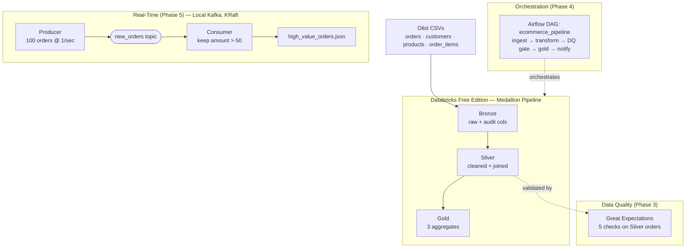

<div align="center">

<a href="https://phiuture.com/tech">
  <picture>
    <source media="(prefers-color-scheme: dark)" srcset="https://res.cloudinary.com/b0tb1mho/image/upload/v1794310202/ymqwl9jz0hpsmdoegmwx.png" />
    
  </picture>
</a>

<em>Thoughtfully Engineered. Crafted for You.</em>

<br/><br/>


# DataNexus

### *From raw checkout data to real-time insight, one medallion layer at a time.*

[](https://phiuture.com/tech/datanexus)


[](LICENSE)


<br/>


</div>

---

## Overview

A production-style data engineering pipeline built on the [Olist Brazilian E-Commerce dataset](https://www.kaggle.com/datasets/olistbr/brazilian-ecommerce). It ingests raw CSVs, refines them through a **Bronze → Silver → Gold** medallion architecture, enforces **data quality** with automated checks, **orchestrates** the flow with Apache Airflow, and streams **real-time orders** through Kafka.

---

## Architecture




**The medallion idea:** three stages of increasing trust. *Bronze* is a faithful, untouched copy of the source (plus audit columns). *Silver* is cleaned and joined. *Gold* is aggregated into the specific numbers the business consumes. If a number looks wrong, you re-derive downward from the layer you trust.

---

## Tech stack

| Layer | Tool |
|---|---|
| Storage & transformation | Databricks Free Edition (PySpark, Delta Lake, Unity Catalog) |
| Data quality | Great Expectations 1.x |
| Orchestration | Apache Airflow 3 (via Astronomer Astro CLI + Docker) |
| Streaming | Apache Kafka (local, KRaft mode, Docker) + `confluent-kafka` client |
| Language | Python / pandas |
| Version control | Git + GitHub |


---

## Project structure

```
CapstoneProject/
├── notebooks/            # Databricks notebooks: 01_bronze, 02_silver, 03_gold
├── great_expectations/   # dq_checks.py + gx/ (HTML Data Docs)
├── airflow/              # Astro project; DAG at dags/ecommerce_pipeline.py
├── kafka/                # docker-compose.yml, producer.py, consumer.py, config.py
├── docs/                 # design notes, screenshots
└── README.md
```

---

## The Gold Layer (what the pipeline is *for*)


| Table | Grain | Business question |
|---|---|---|
| `daily_revenue_by_category` | day × category | What sells, and when? |
| `top_customers` | customer | Who are our highest-value buyers? |
| `rolling_7day_order_volume` | day | Is demand rising or falling? |

---

## Setup & How to Run Each Phase

### Prerequisites
- A Databricks Free Edition account (Community Edition was retired end-2025)
- Docker Desktop (or the Podman bundled with the Astro CLI)
- Python 3.11+
- The Olist dataset from Kaggle (four CSVs: orders, customers, products, **order_items**)

### Phases 1–2 · Bronze / Silver / Gold (Databricks)
1. In Databricks, create schemas `bronze`, `silver`, `gold` and a volume for raw files.
2. Upload the four CSVs, then run the notebooks in order:
   - `01_bronze_ingestion` — loads raw CSVs to Delta tables with `ingestion_timestamp` + `source_file` audit columns.
   - `02_silver_transform` — dedupes, standardises dates, joins in the real customer id → `orders_clean`, `order_items_enriched`.
   - `03_gold_aggregates` — builds the three Gold tables (Z-ordered by date).

### Phase 3 · Data Quality (Great Expectations)
```bash
cd great_expectations
python -m pip install great-expectations pandas
python dq_checks.py          # opens an HTML Data Docs report
```
Runs 5 expectations on the Silver orders table; result and report land in `gx/`.

### Phase 4 · Orchestration (Airflow)
```bash
cd airflow
astro dev start              # local Airflow at http://localhost:8080 (admin/admin)
# In the UI: enable + trigger the "ecommerce_pipeline" DAG, view the Gantt chart
astro dev stop
```

### Phase 5 · Real-Time Streaming (Kafka)
```bash
cd kafka
docker compose up -d         # single-node Kafka (KRaft, no ZooKeeper)
python -m pip install confluent-kafka
# Terminal 1:
python consumer.py
# Terminal 2:
python producer.py
# When done:
docker compose down
```
The producer streams 100 order events; the consumer keeps those over 50 and writes them to `high_value_orders.json` (a micro-batch "Silver landing zone").

---

## Data quality summary

All 5 Great Expectations checks pass on the Silver orders table:
- `order_id` and `customer_id` are never null
- every `order_amount` is positive
- purchase dates fall within the dataset window (2016–2018)
- every order maps to a known customer (referential integrity)

Cleansing decisions applied in Silver:
- 610 products with a missing category are relabelled `"unknown"` (revenue preserved)
- canceled / unavailable orders are excluded from revenue and lifetime value
- lifetime value is grouped by `customer_unique_id` (96,096 real people), **not** `customer_id` (99,441 per-order ids)

---

## Key design decisions

- **Medallion architecture** cleanly separates raw, refined, and business-ready data, so failures are traceable to a layer.
- **`customer_unique_id` vs `customer_id`** — the Olist `customer_id` is unique per *order*, so lifetime value must be grouped by `customer_unique_id` or every customer looks like a one-time buyer.
- **DQ as a gate** — the Airflow `run_dq_checks` task uses a branch operator to either proceed to Gold or quarantine, so bad data can't silently flow downstream.
- **Local Kafka over Confluent Cloud** — a local KRaft broker in Docker avoids a card/signup while using the exact same client code and Kafka concepts.
- **Databricks Free Edition** — the correct current replacement for the retired Community Edition; serverless, so no local Spark install needed.

---

## Deliverables
- Databricks notebooks (Bronze/Silver/Gold) with row counts and schema screenshots
- Great Expectations suite + HTML Data Docs report (5/5 passed)
- Airflow DAG + successful-run Gantt chart
- Kafka producer/consumer + `high_value_orders.json`
- This repository + a 5-minute walkthrough video

---

## License

Licensed under the **Apache License 2.0** — see [`LICENSE`](LICENSE) and [`NOTICE`](NOTICE).

Copyright © 2026 Bitan Paul, phiUture. All Rights Reserved.

---

## About phiUture Tech

**DataNexus** is built by **[phiUture Tech](https://phiuture.com/tech)** — *Thoughtfully Engineered. Crafted for You.*

phiUture Tech is the software half of **[phiUture](https://phiuture.com)** — *Technically Creative.* —
an independent studio with one vision: *Shaping the future for you through technology and creativity.*
The name is the philosophy: **φ**, the golden ratio, for craft and balance, and **U** for you — the
person every product is built around. *Thoughtfully Engineered.* means every product is designed
before it is built; *Crafted for You.* means the engineering exists so the experience feels effortless.

phiUture Tech builds AI & data products, agentic systems, automation, applications, research and
games. Its sister half, **[phiUture Studios](https://phiuture.com/studios)** — *Entertainment First.
Technology Follows.* — makes original music and film.

<div align="center">

[](https://phiuture.com/tech)
[](https://www.youtube.com/@phiuture)
[](https://github.com/thebitanpaul)
[](mailto:thephiuture@gmail.com)

</div>

<details>
<summary><b>Every phiUture link</b></summary>

<br/>

| Personal | Business | Artist |
|----------|----------|--------|
| [](https://github.com/thebitanpaul) | [](https://phiuture.com) | [](https://www.youtube.com/@thebitanpaul) |
| [](https://linkedin.com/in/thebitanpaul) | [](https://www.youtube.com/@phiuture) | [](https://open.spotify.com/artist/6ghDcCBlKzJIgm3e586jpV) |
| [](https://instagram.com/thebitanpaul) [](https://www.threads.com/@thebitanpaul) | [](https://play.google.com/store/apps/dev?id=6358474525178045834&hl=en) | [](https://music.youtube.com/playlist?list=OLAK5uy_km3cjEB2zl59Etcgv9UBKWw800O9G3NdE) |
| [](https://facebook.com/thebitanpaul) | [](mailto:thephiuture@gmail.com) | [](https://music.amazon.com/albums/B0G52QMYDC) |
| [](https://x.com/thebitanpaul_) |  | [](https://music.apple.com/us/artist/thebitanpaul/1858534880) |
| [](https://snapchat.com/t/UgO0Iywr) |  | [](https://www.jiosaavn.com/artist/thebitanpaul-songs/zuo0NgC65gQ_) |
| [](mailto:thebitanpaul@gmail.com) |  |  |

</details>

<br/>

<div align="center">

**phiUture Tech** · *Thoughtfully Engineered. Crafted for You.*

<sub>© 2026 phiUture · Apache License 2.0</sub>

</div>
